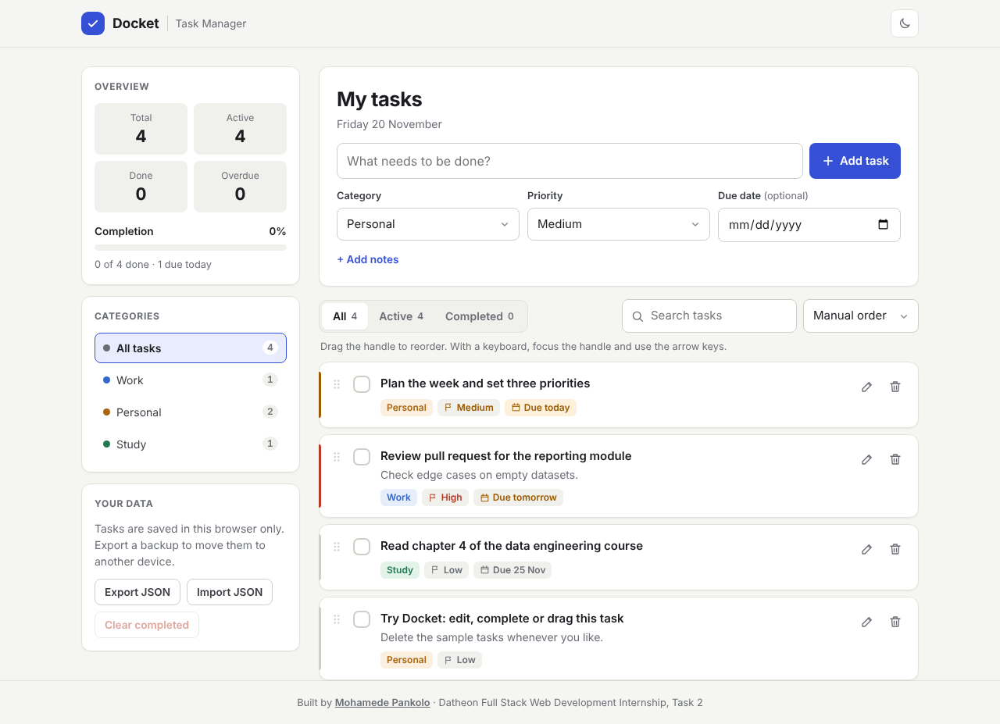

# Docket: Task Manager & Productivity Tracker

**Datheon Full Stack Web Development Internship · Task 2: Dynamic Task Manager (CRUD)**
Built by [Mohamede Pankolo](https://github.com/mohamedepankolo)

Docket is a task manager that runs entirely in the browser. You can create, edit, complete, reorder and delete tasks, sort them by category, priority and due date, and follow your progress. Tasks are saved in `localStorage`, so they are still there after a reload.

Plain HTML5, CSS3 and JavaScript (ES6+). No framework, no build step, no dependencies.



## Features

**CRUD**
- **Create** a task with a title, optional notes, a category (Work, Personal, Study), a priority (High, Medium, Low) and an optional due date.
- **Read** tasks as cards showing category, priority and due status (Overdue, Due today, Due tomorrow, or the date).
- **Update** any field in an edit dialog. Double-clicking a title also opens it.
- **Delete** with an Undo option in a notification, so nothing is lost by accident.

**Organising**
- Mark tasks complete or incomplete, with a short completion animation.
- Filter by status (All, Active, Completed) and by category, with live counts.
- Search titles and notes. Several words narrow the search.
- Sort by manual order, due date, priority or creation date.
- Reorder by drag and drop with a mouse or a finger. With a keyboard, focus the handle and use the arrow keys.
- Clear all completed tasks (asks for confirmation, can be undone).

**Productivity overview**
- Total, active, completed and overdue counts.
- Completion rate with a progress bar and the number of tasks due today.

**Data and settings**
- Automatic `localStorage` persistence through `saveToLocalStorage()` and `loadFromLocalStorage()`.
- Export to a JSON backup and import it again (the import replaces the list after confirmation, and can be undone).
- Saved data is validated on load. A damaged or edited entry is cleaned or skipped instead of breaking the app.
- Light and dark themes. The first visit follows the system setting, then the choice is remembered.
- Filters and sort order are remembered between visits.
- Several open tabs stay in sync.
- Four sample tasks on the very first visit. They do not come back once deleted.

**Quality**
- Mobile-first layout tested at 390 px, tablet and desktop widths.
- Accessible: labelled fields, visible focus, keyboard support for every action, ARIA live announcements, native `<dialog>` with Escape to close, `prefers-reduced-motion` respected.
- Input validation: required title, length limits, no past due dates for new tasks.

## Run locally

Open `index.html` in a browser. Everything works from the file system.

Or serve the folder:

```bash
python3 -m http.server 5500
# then open http://localhost:5500
```

## Tests

**Unit tests** (Node.js 18 or later, nothing to install):

```bash
npm test
```

27 tests cover validation, every CRUD operation, undo, filtering, search, sorting, reordering, statistics, due-date rules, import/export and storage failures (corrupted data, full or blocked storage).

**Browser test** (optional, needs Python and Playwright):

```bash
pip install playwright
python -m playwright install chromium
python tests/e2e_smoke.py           # add --shots to refresh the screenshots
```

It drives a real Chromium window through the whole user journey: creating with validation, editing, completing, filters, search, sorting, keyboard and mouse reordering, delete and undo, reload persistence, clearing completed tasks, theme switching and the mobile layout. It fails on any console error.

## Project structure

```text
Task-2-Task-Manager/
├── index.html            Markup, templates and dialogs
├── css/style.css         Mobile-first styles, light and dark themes
├── js/
│   ├── core.js           Pure task logic (CRUD, filters, sorting, stats, validation)
│   ├── storage.js        localStorage load/save with error handling
│   └── app.js            State, rendering and event handling
├── assets/favicon.svg
├── tests/
│   ├── core.test.js      Unit tests for core.js
│   ├── storage.test.js   Unit tests for storage.js
│   └── e2e_smoke.py      Browser test (Playwright)
├── screenshots/
├── package.json          npm test script
└── README.md
```

## How it works

- **State.** The app keeps one array, `tasks`, in memory. Each task has `id`, `title`, `notes`, `category`, `priority`, `dueDate`, `completed`, `createdAt`, `updatedAt` and `completedAt`. The array order is the manual order.
- **Logic.** `core.js` contains pure functions that return a new array rather than changing the old one (`addTask`, `updateTask`, `deleteTask`, `toggleTask`, `reorderSubset`…). This keeps the UI predictable and lets the same code run in Node for tests.
- **Changes.** Every change goes through one `commit()` function, which saves to `localStorage` and re-renders.
- **Rendering.** The visible list is the result of filtering then sorting `tasks`. Each card is cloned from a `<template>`. Text is inserted with `textContent`, never `innerHTML`, so task content cannot inject HTML.
- **Reordering a filtered list.** When only some tasks are visible, the new order is written back into the slots those tasks already occupied, so hidden tasks keep their place.
- **Storage keys.** `docket.tasks.v1` for tasks, `docket.prefs.v1` for filters, sort order and theme.

## Deployment

Static site, no build command. On Netlify, set the publish directory to `Task-2-Task-Manager` (or to the repository root if the project is published on its own).

## Notes

- Data lives in the current browser only. Use Export JSON to move it to another device.
- The date picker's display format follows the browser's language settings.

## License

MIT © 2026 Mohamede Pankolo
